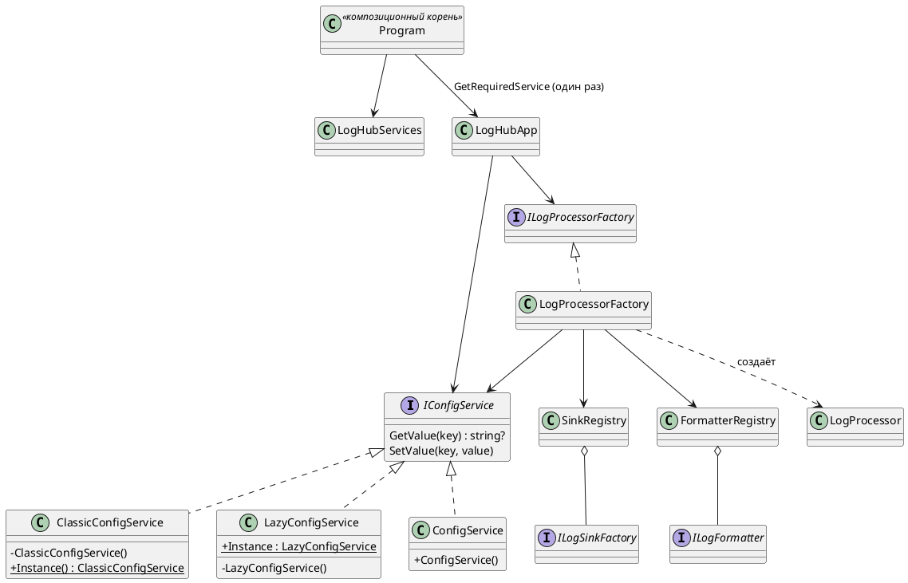

# Лабораторная работа 5 (ЛР 2 раздела «Паттерны»). IoC, DI-контейнер и Синглтон

**Студент:** Нагорная Софья, БИСО-01-24
**Вариант:** 2 — CSV с заголовком, приёмники: консоль, SQLite (пока консоль, файл и заглушка БД)
**Репозиторий:** ссылка
**Pull Request:** ссылка

---

## Задача

Реализовать сервис конфигурации `IConfigService` тремя способами (классический синглтон, синглтон на `Lazy<T>`, обычный класс для контейнера), воспроизвести на тестах проблему глобального состояния, собрать LogHub на `Microsoft.Extensions.DependencyInjection` и сделать два профиля (console и file), переключаемые правкой конфигурации без перекомпиляции.

---

## Диаграмма классов



---

## Применённые паттерны

| Паттерн | Где применён | Почему именно так |
|---|---|---|
| Singleton (классический) | `ClassicConfigService` | закрытый конструктор, `Instance()`, двойная проверка с `lock` по отдельному объекту и `volatile`. Сделан для сравнения |
| Singleton (`Lazy<T>`) | `LazyConfigService` | то же без ручной блокировки: потокобезопасность даёт `Lazy<T>` |
| Dependency Injection | всё приложение | зависимости приходят через конструктор, контейнер собирает граф |
| Фабрика | `LogProcessorFactory`, фабрики приёмников | процессор зависит от настроек, известных только после чтения конфигурации, поэтому контейнер выдаёт фабрику |
| Реестр | `SinkRegistry`, `FormatterRegistry` | выбор реализации по имени из конфигурации (из ЛР 4) |

---

## Ключевые решения

- **Интерфейс `IConfigService` из двух методов** (`GetValue`, `SetValue`), как в задании. Типизированные свойства (`Sink`, `Format`) остались в `LogHubConfig`, который теперь читает значения из сервиса.
- **В контейнере живёт `ConfigService` со временем жизни Singleton.** Сам класс про «единственность» не знает, поэтому в тесте можно создать новый экземпляр.
- **`PluginCatalog` больше ничего не создаёт.** Он находит типы в сборке и регистрирует их в контейнере (`AddAll<T>`). Новый приёмник по-прежнему добавляется одним файлом, но строит его контейнер, а не `Activator`.
- **Швы для внешнего мира:** `ITextWriterFactory` (диск), `IDbClientFactory`, `IConsoleOutput`, `TimeProvider`. Фабрики приёмников получают их через конструктор, поэтому тест профиля `file` не касается диска.
- **`LogProcessorFactory` вместо `LogProcessor` в контейнере.** Процессор нужно строить после загрузки конфигурации. `new LogProcessor(...)` оставлен внутри фабрики.
- **Проверка контейнера при сборке:** `ValidateScopes` и `ValidateOnBuild` включены в `BuildLogHubProvider`.
- **Один доступ к провайдеру:** `provider.GetRequiredService<LogHubApp>()` в `Program.cs`. Других `GetService` в коде нет.
- **Порядок тестов классического синглтона** зафиксирован `AlphabeticalOrderer`, чтобы проблема воспроизводилась каждый раз.

---

## Профили

| Профиль | Файл | Запуск |
|---|---|---|
| console | `samples/loghub.console.config` | `dotnet run --project src/LogHub -- samples/sample.log samples/loghub.console.config` |
| file | `samples/loghub.file.config` | `dotnet run --project src/LogHub -- samples/sample.log samples/loghub.file.config` |

Переключение — выбор другого файла (или правка `sink =` в `loghub.config`) и новый запуск. Код не пересобирается.

<!-- ЗАПОЛНИТЬ: вывод запуска профиля console -->

<!-- ЗАПОЛНИТЬ: запуск профиля file и первые строки файла loghub-output.txt -->

---

## Чем Singleton отличается от AddSingleton

Паттерн Singleton делает две вещи сразу: ограничивает число экземпляров (закрытый конструктор) и даёт глобальную точку доступа (`Instance()`). `AddSingleton` оставляет только первое: экземпляр один, но живёт в контейнере и приходит в потребителя через конструктор.

Это видно по тестам:

- `ClassicSingletonTests.A_LoadFileProfile_ChangesSharedState` записывает `sink = file` в `Instance()`. Тест `B_DefaultSinkIsConsole_BreaksAfterA` ждёт, что значения нет. Запущенный отдельно, B проходит; после A (порядок задан `AlphabeticalOrderer`) — падает. Состояние осталось в статическом поле и никак не сбрасывается без reflection. Поэтому B помечен `Skip` с объяснением, иначе CI красный.
- `ContainerSingletonTests.NewInstance_StartsWithDefaults_RegardlessOfOtherTests` и `TwoContainers_HaveTheirOwnSingletons`: каждый тест создаёт свой `ConfigService` или свой контейнер, общего состояния нет, зависимости от порядка быть не может.
- `CompositionTests.OwnConfigService_ReplacesDefaultOne` подставляет свою реализацию `IConfigService` без каких-либо сбросов. С `Instance()` в потребителе так сделать нельзя: класс сам берёт то, что ему не дали.
- `AddSingleton_GivesTheSameInstanceEveryTime` и `AddTransient_GivesDifferentInstances` показывают, что «один экземпляр» — это настройка регистрации, которую можно поменять в одной строке.

Итог: первое нетестируемо из-за скрытой глобальной зависимости (потребитель сам идёт за `Instance()`), второе тестируемо, потому что зависимость явная и заменяемая.

---

## Тесты

```
$ dotnet test
```

<!-- ЗАПОЛНИТЬ: итоговая строка вида "Passed! - Failed: 0, Passed: N, Skipped: 1" -->

<!-- ЗАПОЛНИТЬ: запуск B отдельно (с --filter) и вывод падения при снятом Skip -->

Тесты не трогают диск, сеть и базу: файл подменяется `StringWriter`, консоль — `FakeConsole`, БД — записывающей заглушкой.

---

## Что не получилось

- `new` вне корня всё же остались в нескольких местах: `LogProcessorFactory` создаёт `DelimitedLogParser` и `LogProcessor`; `FormatterRegistry` создаёт `MessageOnlyFormatter` как значение по умолчанию; фабрики `FileWriterFactory` и `FakeDbClientFactory` создают поток и клиента. Считаю фабрики допустимым исключением, но формально это не «только в корне».
- Сброс состояния классического синглтона не сделан намеренно: это и есть демонстрация проблемы.
- Реальной работы с SQLite по-прежнему нет, только заглушка БД.
- Код писался без компилятора, первая проверка — сборка с `-warnaserror` и CI.

---

## Источники

- Лекция №3 (IoC, DI, времена жизни), учебник, главы «Singleton», «IoC и внедрение зависимостей»; схема двойной проверки блокировки — из материалов курса, код написан заново.
- Код и тесты подготовлены с помощью языковой модели (Claude, Anthropic) и проверены мной.
- Документация Microsoft по `Microsoft.Extensions.DependencyInjection`, `Lazy<T>`, `TimeProvider`.

---

## Ответы на контрольные вопросы

1. **Двойная проверка без `volatile`.** Без барьера памяти запись ссылки может стать видимой другому потоку раньше, чем завершится конструктор. Второй поток увидит не `null` и вернёт наполовину созданный объект. `volatile` запрещает такую перестановку.
2. **`lock(this)`.** `this` виден снаружи, любой чужой код может взять блокировку на том же объекте и вызвать взаимную блокировку или лишнее ожидание. Блокируют по закрытому объекту.
3. **Композиционный корень.** Единственное место у точки входа, где собирается граф объектов. Он один, чтобы остальной код про контейнер не знал, иначе получится Service Locator.
4. **Времена жизни.** Transient — новый объект на каждый запрос (лёгкие сервисы без состояния); Scoped — один на область (запрос, единица работы); Singleton — один на контейнер (настройки, кэши, обязательно потокобезопасные).
5. **Captive dependency.** Singleton держит Scoped или Transient и продлевает ему жизнь. Ловится `ValidateScopes` и `ValidateOnBuild`, включены в `BuildLogHubProvider`.
6. **Синглтон как нарушение DIP.** Не всегда. Нарушение — классический `Instance()`, потому что потребитель зависит от конкретного класса. Один экземпляр в контейнере за интерфейсом (`ConfigService`) принципа не нарушает.
7. **Конструктор или свойство.** Через конструктор зависимости обязательны и видны, объект после создания готов, поля можно сделать `readonly`. Свойство можно забыть задать, получится `null`. Свойство годится для необязательных зависимостей.
8. **Конструктор на десять параметров.** Это не проблема DI, а сигнал, что класс делает слишком много (SRP). Контейнер лишь делает это заметным. Лечится разбиением класса.
